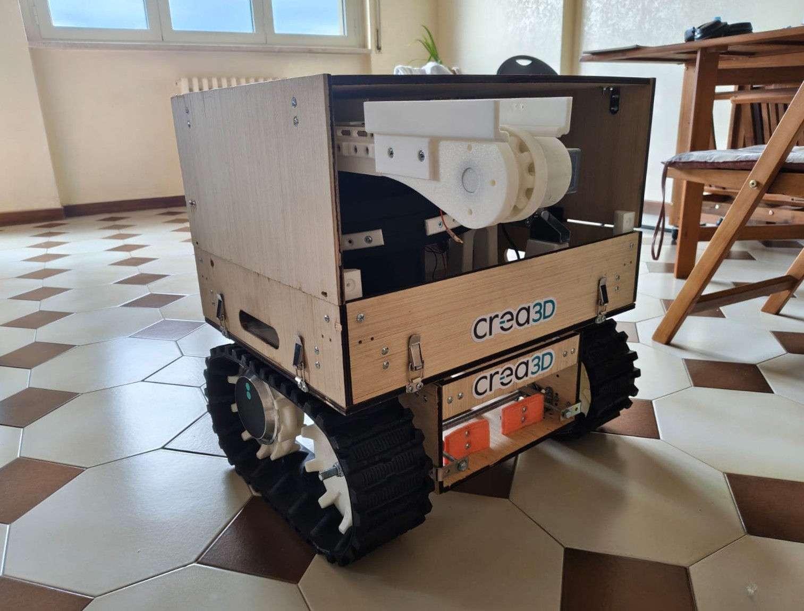

# ARGO - Assembly guide for version 2.0

## What's new
In the second version, a great many new features have been added, and it has been given a more professional look compared to the first prototype.In the second version, all the individual modules have been made independent and more space-efficient. Thus, unlike the first version, we have:

- **A rover module** powered by two motors salvaged from a hoverboard;
- **A buffer module** inspired by a conveyor system but completely redesigned to meet space constraints;
- **A scanner module** which has remained conceptually unchanged;
- **A remote unit** an addition, along with the rover module, not present in the first version, which transmits UWB signals to the rover, enabling the robot to autonomously follow the archaeologist. It also features a screen and buttons to provide useful information to the operator.

---

## Rover Module

---

## Buffer Module

---

## Scanner Module

---

## Remote